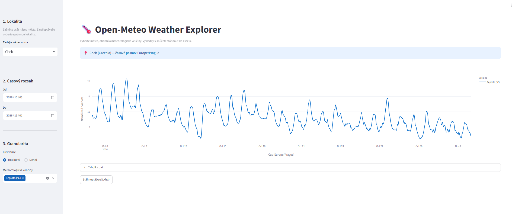

# 🌡️ Open-Meteo Weather Explorer

**Version 1.0.0 · Developed by Tataboj**



> **🌐 Live Demo:** Not deployed yet. The public link will be added only after a separately authorized and verified deployment.
>
> **⬇️ Download v1.0.0:** Once published, use **Releases → v1.0.0** to download the official version. For source files, use **Code → Download ZIP**. No release has been published yet.

Interactive historical weather explorer built with **Python, Streamlit, pandas, and Plotly**. Search worldwide locations, plot hourly or daily weather data in the selected location's timezone, and export results to Excel.

**Author:** Tataboj · **License for original source:** [MIT](LICENSE) · **Data:** [Open-Meteo Historical Weather API](https://open-meteo.com/en/docs/historical-weather-api).

Open-Meteo data have their own terms and attribution requirements; see [third-party notices](THIRD_PARTY_NOTICES.md). This is an independent project, not affiliated with or endorsed by Open-Meteo.

## Features

- Single-field autocomplete powered by the Open-Meteo geocoding API: shows actual place, region and country, with Czech-first ranking for exact matches; choose a suggestion if multiple places match
- Known Czech alias `Hranice na Moravě` is searched as `Hranice`; a country suffix such as `Cheb, CZ` limits the candidates
- The search field starts empty. Users can select a geocoding suggestion; typed unambiguous exact matches are also resolved by the backend where the searchbox exposes the current text.
- Clean initial screen with no network request until the user searches; loading indicators during city search and weather-data retrieval; reduced developer toolbar
- Hourly temperature, humidity, precipitation, and wind speed
- Daily maximum/minimum temperature, precipitation, and maximum wind speed
- Local timezone presentation with DST-aware hourly labels (23/24/25-hour days)
- Excel export with Czech dates and unambiguous local-time UTC offsets

## Run locally

Requires **Python 3.12**.

### Windows (quick start)

> ⏳ **First launch: allow approximately 1–3 minutes (sometimes longer).** On the first run, the launcher creates a Python environment and downloads required libraries. The time depends on your connection and computer. Later launches normally take less time because dependencies are already installed. Keep the terminal window open while the app runs.

1. Install **Python 3.12** from [python.org](https://www.python.org/downloads/) with the Windows `py` launcher.
2. Download the GitHub ZIP and **extract it** (do not run directly inside the archive).
3. Open the extracted project folder and double-click **`run.bat`**.
4. The script automatically prepares the environment and starts Streamlit. Wait for the browser to open; do not close the terminal window.
5. Open <http://localhost:8501> if the browser does not open by itself; stop with Ctrl+C in the terminal.

An internet connection is needed during installation and for weather queries. Only run scripts from sources you trust.

### Windows (manual, PowerShell)

```powershell
py -3.12 -m venv .venv
.\.venv\Scripts\python.exe -m pip install -r requirements.txt
.\.venv\Scripts\python.exe -m streamlit run app.py
```

### macOS / Linux

```bash
python3.12 -m venv .venv
.venv/bin/python -m pip install -r requirements.txt
.venv/bin/python -m streamlit run app.py
```

Open **http://localhost:8501** (Streamlit normally opens this automatically). Stop the server with Ctrl+C.

## Tests

```bash
python -m pip install -r requirements-dev.txt
python -m pytest -q
```

The tests cover DST transitions, Excel export, date validation, and a mocked geocoding response. External API connectivity is not included in unit tests.

## Deploy online (optional)

1. Commit and push to a GitHub repository using GitHub Desktop.
2. In [Streamlit Community Cloud](https://share.streamlit.io/), select your GitHub repository and branch.
3. Set the app entrypoint to `app.py`, using Python 3.12 in the deployment settings.
4. Deploy and verify the app URL, weather queries, timezone display, and downloaded Excel file.

**This repository is not automatically deployed by GitHub.** Streamlit Community Cloud is a separate hosting service. Publishing/deployment requires explicit owner approval. See [deployment and release checklist](docs/DEPLOYMENT.md).

> **Online visitors:** Public Streamlit Community Cloud apps can sleep after a period without traffic. A visitor may need to wake a sleeping app and wait for it to start. This is different from installing the local application for the first time.

## Project layout

```text
app.py                 Streamlit user interface
src/config.py          API endpoints and variable lists
src/weather_service.py Open-Meteo API client
src/data_processing.py Timezone, date and export transformations
src/excel_export.py    XLSX generation
tests/                 Unit tests
.github/workflows/     CI tests on GitHub
screenshots/            Screenshot of the actual application
docs/                   Deployment/release checklist
LICENSE                 MIT license for original code
THIRD_PARTY_NOTICES.md  Open-Meteo data and dependency notices
CHANGELOG.md            Version history
```

## Notes and limitations

- Historical archive availability varies by date, location, and weather variable.
- Hourly data is retrieved in UTC and converted to the location's timezone. Daily data is requested in the location's timezone for local calendar-day aggregation.
- Hourly API requests include a one-day UTC buffer at each end, then trim strictly to the requested **local** calendar dates. This includes all 24 normal hours, 23 spring-forward hours, or 25 fall-back hours, with no spillover beyond the selected end date.
- `.cache/` and `.venv/` are local, git-ignored directories.
- Python dependencies are constrained by compatible ranges rather than locked to an exact transitive environment; production releases may add a tested lock file.
- Original application source is published under MIT, © 2026 Tataboj. Third-party packages and weather data retain their own respective terms.
- v1.0.0 is **prepared only**; a public GitHub repository, official tag/release and hosted demo require distinct, explicit approval and verification.
